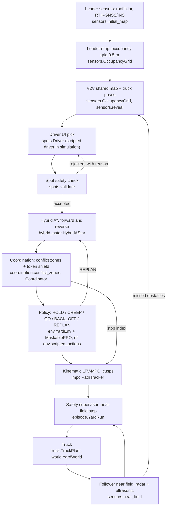

# Convoy parking in a staging yard: design (v1)

This document gives the reasons behind the yard parking stack in `nohesi/yard/`. `docs/yard_interfaces.md` is the
module contract, and `nohesi/yard/config.py` holds every parameter. Values quoted here are config versions `t1`, `s1`,
`y1`, `p1` (scenario `yard1`) and env `ye1`. "Start" marks a starting value to tune, not a validated one.

**Why this exists.** The haul-road test (`results/haul_obstacles_2026-11-15/REPORT.md`) ran the road ('No Hesi') stack
on static obstacles, and two of its failures shaped this design:

- **Standstill deadlock.** A car stopped 0.2 m behind an obstacle had no forward-only way out, and the stack had no
  reverse. On `h1` seed 1000 all three cars sat still from about 65 s to the end, through 6,522 infeasible solves.
- **Low speed.** The road planner broke at 5–7 m/s, below its tyre model's 5 m/s floor (`nmpc_vx_floor`).

The yard stack answers both. Reverse exists at two levels: in planned paths, and as the BACK_OFF action. The tracker
uses a kinematic model that is valid down to standstill. The road stack stays untouched.

## 1. Goal and operating concept

**Goal.** A convoy of rigid haul trucks arrives at a staging yard: a pad beside the haul road, or a log landing. The
followers then park autonomously in spots the leader's driver chose. No collision is allowed, and the yard should be
filled in the least time.

| Actor | Role in v1 |
|---|---|
| Driver (in the leader) | Drives the leader to the scan pose. Starts the scan and checks the processed map on the cab display. Picks one spot per follower (up to 3). Confirms the yard is closed to people and light vehicles. Holds the remote stop for all followers. |
| Leader truck (human-driven, instrumented) | Scans the yard (roof lidar) into an occupancy grid. Runs the spot check, the coordinator and the policy. Broadcasts the map, the spots and the stop limits over V2V. Stays parked at its scan pose for the whole episode. |
| Followers (autonomous, 1–3) | Queue on the access road, 14 m apart. Each plans its own path and drives it under the shield's limits. Each reports its pose and any near-field detections, which update the shared map. A follower stops on its safety supervisor, on a remote stop, or when its permission lapses (section 2). |
| Fleet / site system | Supplies the yard boundary, the berm lines and the entrance (here: `Site`). Also supplies the RTK corrections, the site radio network and the remote-stop infrastructure. It declares the yard an autonomous zone, logs everything and allows remote monitoring. In simulation it is implicit. |

**Sequence.**

1. The convoy drives the access road (60 m × 16 m) to the yard entrance, a 16 m gap in the west berm.
2. The leader pulls in to its scan pose, (12, 56) m, heading 0. The followers wait on the road.
3. The leader scans. The grid shows free, occupied and unknown ground on the cab display.
4. The driver picks a spot per follower, in queue order. The check accepts the pick or names the reason it is rejected.
5. Each accepted spot comes with a Hybrid A* path from that follower's position.
6. The followers drive. The coordinator gives each truck the last path sample it may reach. Every 0.5 s the policy
   picks HOLD, CREEP, GO, BACK_OFF or REPLAN for each follower.
7. A follower is parked when it stands within 0.5 m and 0.1 rad of its spot.
8. The episode ends when all followers are parked, on a collision, after 300 s, or after 40 s with no truck moving.

**Operational design domain (v1).**

| Item | v1 value or assumption |
|---|---|
| Yard | 100 m × 70 m pad with 2 m berms and one 16 m entrance. Flat (2D). |
| Trucks | Rigid haul truck, about 40 t payload class: 9.5 m × 3.8 m, wheelbase 4.2 m. Full lock 0.48 rad gives a rear-axle turning radius of 8.1 m. A leader plus 1–3 followers. |
| Speeds | At most 3.0 m/s forward and 1.5 m/s in reverse. CREEP is 0.7 m/s. Lateral acceleration is capped at 0.8 m/s². |
| Obstacles | Static only: berms, 2–6 rock piles (2.5–6 m), 0–3 parked machines (8 × 3.5 m) and 0–2 windrows (12–20 × 1.5 m). The scan misses rocks and windrows with probability 0.15. |
| People and light vehicles | None in the yard while followers move. This is enforced by site procedure and confirmed by the driver. Not modelled. |
| Dust | Moderate: lidar range derated to 60 m. Heavier dust that shortens the usable range is outside the ODD: rescan or wait (design choice). |
| GNSS | An RTK fixed solution is needed for autonomous motion. When the fix is lost, the follower comes to a controlled stop on INS and odometry (design choice). Simulation: exact poses. |
| Light | Day and night. Lidar, radar and ultrasonics do not need light. The driver picks on the rendered scan, not on camera images. |
| Weather | Dry or light rain. Heavy rain, snow and fog are outside the ODD until tested. |
| Radio | V2V across the yard (≤ about 150 m). A separate remote-stop radio. Simulation: exact and instant. |

**Out of scope for v1:** articulated haulers and truck-trailers, slopes and terrain models, moving people and
vehicles, sensor noise, latency and localisation error, a real cab UI, rescans or a leader that moves after its scan,
leaving the yard, and more than 3 followers.

## 2. Architecture

| Box | Module | Rate in simulation |
|---|---|---|
| Leader scan | `sensors.initial_map` | Once, at the scan pose |
| Shared map | `sensors.OccupancyGrid`, `reveal` (`ClearanceMap` for the planner) | Reveal every `dt` (0.1 s) |
| Driver pick, spot check | `spots.Driver`, `spots.validate`, `spots.candidates` | Per pick, and when a spot is reassigned |
| Path planning | `hybrid_astar.HybridAStar.plan`, `collision_free` | Per accepted pick and per REPLAN |
| Coordination | `coordination.conflict_zones`, `Coordinator.update` | Zones per new path. Stop limits every `mpc_step` (0.2 s). |
| Policy | `env.YardEnv` (training: `nohesi/rl/train.py`'s MaskablePPO). Baseline: `env.scripted_actions`. | Every `decision_interval` (0.5 s) |
| Tracking | `mpc.PathTracker.command` | Every `mpc_step`. Predicts 15 × 0.2 s = 3 s ahead. |
| Safety supervisor | `episode.YardRun` (uses the true geometry within `near_range`) | Every `dt` |
| Plant, ground truth | `truck.TruckPlant`, `world.YardWorld` | Every `dt` |
| Loop, record, plots | `episode.YardRun`, `YardEpisode`, `viz.py`. Parameters: `config.py`, `scenarios.py`. | |

**Where it runs on real trucks (design choice).**

- **Leader computer:** the map, the UI, the spot check, the coordinator and the policy. The policy is centralised: one
  network picks all three followers' actions.
- **Each follower:** plans its own path on the shared map, and runs its MPC and its supervisor on board.
- **Stop limits are leases.** A follower that has no fresh stop limit within a timeout comes to a controlled stop
  before its next gate. The timeout is to be set from the measured radio latency; 1 s is the start. This is the same
  idea as a movement permission that expires.
- **Losing the link stops a follower.** Losing the leader stops all of them. Both are safe, but they cost availability.

## 3. Sensor suite

**The market.** The target is retrofit kits on 40–100 t rigid haul trucks in quarries and mid-size mines. These sites
are dusty, sometimes have poor GNSS in pits, and are cost-sensitive.

**Market context.** Public descriptions of commercial autonomous haulage combine:

- high-precision GNSS with inertial sensing;
- radar and lidar for obstacle detection;
- a central fleet management system;
- a remote stop.

ISO 17757:2019, the safety standard for autonomous machines in earth-moving and mining, requires a means to stop
the machine from a safe remote distance. It also requires operator intervention before motion restarts after such a
stop.

Retrofit autonomy kits for quarry and mid-size mining fleets are on sale today, for example from Pronto, SafeAI and
Epiroc. Their public descriptions range from camera-first kits for quarries to GNSS + lidar + radar stacks for mines.
We did not verify their specifications.

**Principles of the suite.**

- **Radar for the safety function in dust.** At 77 GHz the wavelength is about 4 mm, far larger than dust particles,
  so dust scatters it far less than light.
- **Lidar for geometry.** Mapping berms, rocks and equipment needs lidar's resolution. Lidar degrades in dust: it can
  return the edge of a dust cloud as a surface (Phillips et al., 2017), which is why the simulation derates its range.
- **GNSS/INS for pose.** Dual antennas give heading at standstill, which matters because every follower plans from
  rest.
- **Cameras for people.** They serve the display and remote monitoring, not the safety function.
- **An independent radio for the stop.**

**Leader (human-driven: scan and driver display).**

| Sensor | Count | Placement | Purpose | Dust and vibration | Simulation |
|---|---|---|---|---|---|
| RTK-GNSS, dual antenna, with an INS and wheel-speed input | 1 system, 2 antennas | Antennas as far apart as the roof allows. IMU on the frame near mid-truck. | Scan pose and map frame. Heading at rest. | GNSS is unaffected by dust. Pit walls cause multipath and outages, which the INS bridges. Use rated, isolated mounts. | Exact pose |
| 360° lidar (3D, multi-beam) | 1. Add a 2nd if the body hides the rear arc. | High, on a mast at the front deck or the canopy edge. On most rigid haul trucks the body's canopy covers the cab. | The yard scan | Range falls in dust, and dust clouds can show as obstacles. Needs window cleaning (air knife or wiper) and an isolated mount. | 2D ray cast, 360°, 0.5° rays, 60 m, 6 m ahead of the rear axle, no self-occlusion. Low obstacles missed with p = 0.15. |
| Surround cameras | 4–6 | Corners and rear | Display overlay, follower video, records | Lenses foul in dust. Need work lights at night. Not used for safety. | Not modelled |
| Cab display (rugged touchscreen) | 1 | Cab | Scan view, picks, rejection reasons, follower status | Glare- and glove-proof | `spots.Driver` model |
| V2V radio | 1 | Roof | Map, spots, poses, stop limits | Not affected by dust | Exact, no latency |
| Remote-stop transmitter | 1 | Driver's hand or the dash | Stops every follower | Its own radio, independent of V2V | Not modelled (assumed to work) |
| Compute | 1 | Cab | Mapping, check, planning, coordination, policy | Rugged, sealed | Not modelled |

**Each follower (autonomous).**

| Sensor | Count | Placement | Purpose | Dust and vibration | Simulation |
|---|---|---|---|---|---|
| RTK-GNSS, dual antenna, + INS + wheel odometry | 1 system, 2 antennas | As on the leader | Localisation, heading at rest, a controlled stop when the fix is lost | Wheel slip on gravel limits odometry | Exact pose |
| Forward long-range: 4D imaging radar (or lidar) | 1 | Front bumper or deck | Path check ahead, mostly for the haul road. In the yard, a second view of the path. | Radar is the choice for dust | Not separate: covered by the 10 m near field |
| Rear long-range: 4D imaging radar (or lidar) | 1 | Rear, below the body | Reversing toward berms and trucks at 1.5 m/s | As above. Keep it clear of material falling from the body. | Not separate |
| Short-range corner radars | 4 | Four corners | 360° near field, the supervisor's main input | Robust in dust. Multipath near metal and berms, weak returns from small low objects. | `near_field`: 10 m, 8 rays. The supervisor uses the true geometry within 10 m. |
| Ultrasonic arrays | 8–12 | Rear bumper and corners, front bumper | The last metres when reversing in. Low objects at the bumper. | Range of a few metres. Mud cake and noise affect them. Cheap. | Part of the 10 m near field |
| Surround cameras | 4–6 | Corners, rear | Remote monitoring by the driver or the control room. Records. | As on the leader | Not modelled |
| V2V radio + remote-stop receiver | 1 + 1 | Roof | Map, poses, stop limits. A stop that does not depend on V2V. | | Exact |
| Compute: autonomy computer + safety controller | 1 + 1 | Cab or electronics box | Planner and MPC; a separate safety-rated controller for the supervisor, the remote stop and the drive-by-wire watchdog | Sealed, vibration-rated | Not modelled |
| Drive-by-wire (actuation, not sensing) | 1 set | Steering, throttle, service and park brakes, transmission direction | Executes the MPC's commands | | `TruckPlant`: steer-rate limit, 0.4 s acceleration lag, direction selector |

An optional roof lidar on each follower would add that follower's own scans to the shared map. v1 does not model it.

**Radio.** For V2V we assume the site provides a private LTE/5G network or an industrial mesh (Rajant is one mesh
vendor used on mine sites). The remote stop runs on its own radio, so a congested or failed data network cannot block
it. This is a design choice.

**Vendors.** GNSS/INS receivers of this class come from vendors such as Trimble, NovAtel and Septentrio. 360° lidars
come from vendors such as Ouster and Hesai. These are examples of categories, not recommendations, and we did not
check their specifications.

**Cost.** We give relative tiers per truck only, not prices:

| Tier | Components |
|---|---|
| Low | Ultrasonic arrays, corner radars, cameras |
| Medium | 4D imaging radars, radios, compute |
| Medium to high | 360° lidar; RTK dual-antenna GNSS with INS, where the IMU grade drives the cost |

Prices vary widely with volume, ruggedisation and supplier. We expect integration to dominate a retrofit's cost more
than the sensors do: drive-by-wire, mounting, wiring, the safety case and certification. That is an expectation, not
a measured figure.

## 4. Spot selection and safety rules

**The driver.** The driver sees the grid, the leader, the queued followers and the candidate spots: a lattice every
3.0 m with four headings, filtered by the static checks. The driver taps a spot and can rotate it. The spot's default
heading is nose-out (section 5).

`spots.validate` returns the first failing reason, cheapest check first. The driver cannot override a rejection in v1
(design choice). In simulation, `spots.Driver` makes 30 % of its picks free clicks (`driver_bad_pick`). Free clicks
are usually unsafe, so they exercise the rejection path. Its other picks favour spots along a berm with the nose out,
3:1.

| Reason | Rule | Value | Why |
|---|---|---|---|
| `outside` | The footprint is not inside the yard shrunk by `spot_margin` | 1.0 m | Keeps the body off the berm toe and the yard edge |
| `entrance` | The footprint is within `keep_clear` of the entrance centre | 18 m | A parked truck must not block later arrivals or the way out |
| `leader` | Within `spot_spacing` of the leader's footprint | 2.5 m | The leader is a truck with a driver in it |
| `too_close` | Within `spot_spacing` of another assigned spot | 2.5 m | Room for each truck's planned clearance and parking error (below), and access on foot |
| `occupied` | A cell within `spot_margin` of the footprint is OCCUPIED | 1.0 m | A known obstacle or berm. It takes precedence, since the lidar maps only an obstacle's near face. |
| `unscanned` | A cell within `spot_margin` is UNKNOWN (or off the grid) | 1.0 m | Unknown is not free (below) |
| `unreachable` | Hybrid A* finds no path from the follower's pose | `max_expansions` 6000 | The path avoids the map, the leader, followers later in the queue where they stand, and the spots already assigned |

**Why unknown ground is not free.**

- **A ray certifies only what it saw.** It certifies free space up to its first hit and no further. The ground behind
  a parked machine or a rock pile was never seen, and a rock, a hole or a person may be there.
- **Some ground is out of range.** From the scan pose, about 69 % of the yard lies within the 60 m lidar range,
  before any occlusion. The rest stays unknown.
- **Late discovery costs too much.** If unknown counted as free, the planner would route through unseen ground and
  learn about it from the 10 m near field. At 3 m/s that is about 3 s of warning, against a 9.9 m comfortable stop.
- **What remains is the missed obstacles.** Treating unknown as blocked leaves only the obstacles the scan missed
  (`miss_prob`, low rocks and windrows), which read as free. The followers' near field reveals them into the shared
  map. A path they block makes the truck stop 4 m short of them (`BLOCK_BUFFER`) and wait for a REPLAN. A spot they
  make unsafe is reassigned by the driver (the 'reassigned' event).

**The margins add up.** The planner keeps 0.6 m between the body and anything non-free. On top of that, the cover
disks over-cover the body by up to 0.34 m at the sides, and the clearance map subtracts half a cell diagonal
(0.35 m). Spot spacing is 2.5 m. That covers both trucks' planning clearances (2 × 0.6 m) plus the park tolerance on
each (2 × 0.5 m), with 0.3 m to spare.

A truck parked at the heading tolerance (0.1 rad) swings its front corners up to about 0.74 m. Its neighbour's path
can then be blocked, which ends in 'unreachable' or a failed replan. Spacing is a start value: tune it on the
`too_close` and `replan_failed` counts.

## 5. Path planning (Hybrid A*)

**The search.** The planner follows Dolgov et al. (2010).

- **States:** continuous rear-axle (x, y, yaw). The closed set is binned at 1.0 m and 5° (72 bins).
- **Primitives:** 2.0 m arcs at steer fractions −1, −0.5, 0, 0.5 and 1 of `steer_max`, forward and reverse: 10
  primitives.
  - A full-lock arc turns 14.2°, and a half-lock arc (17.2 m radius) turns 6.7°. Every turning primitive therefore
    leaves its parent's yaw bin.
  - Samples along each primitive are at most 0.5 m apart. Each is checked with the 4 cover disks (radius 2.24 m)
    against the clearance map, plus 0.6 m.
- **Cost, in metre-equivalents:**
  - arc length, × 1.5 in reverse;
  - + 6.0 per change of direction (a cusp means stop, shift, restart: about 6 s on this truck);
  - + 0.3 per unit of steer fraction;
  - + 0.3 per unit change of steer fraction.
- **Heuristic:** max(Euclidean distance, 2D grid distance to the goal), weighted by `heuristic_weight` 1.5.
  - The grid distance is computed with Dijkstra over cells where the rear axle has at least `width/2` (1.9 m) of
    clearance. Every collision-free pose satisfies that, and reverse costs ≥ 1 per metre, so the grid distance is a
    lower bound on the cost. The exception is 8-connected grid error, at most about 8 %.
  - With the weight of 1.5, cost is traded for speed: paths are within about 1.5 times the optimum.
- **Analytic shots:** a Dubins shot at full-lock radius closes the search. It is tried every 4 expansions within 45 m
  of the goal, forward and reverse. A reverse shot is the forward Dubins path from the goal to the node, driven
  backward. A collision-free shot ends the path exactly at the spot.
- **Failures:** 'start_blocked', 'goal_blocked', 'no_path' (search exhausted) and 'budget' (6,000 expansions).

**Geometry worth knowing.**

- **U-turns.** A forward U-turn at full lock sweeps the outer front corner through a 12.4 m radius. With margins
  that needs about 26 m of clear width, so many manoeuvres between obstacles need a cusp.
- **Speed on curves.** The lateral cap of 0.8 m/s² limits speed on a full-lock arc to 2.5 m/s.

**Reverse-in parking (nose out).** The spot's heading decides the manoeuvre. The planner ends at whatever pose it is
given. With the nose toward the entrance, a truck arriving from the entrance usually drives past, stops at a cusp and
reverses in. This is the default for four reasons:

- **The reverse happens under the best conditions.** It is done once, just after a fresh scan, at ≤ 1.5 m/s, with
  every truck's pose known and the yard closed to traffic.
- **Departure is forward.** The truck leaves later, when the yard may have changed. It then leaves with its forward
  sensors leading (and a driver's view, if it is manned by then).
- **Along a berm, the rear faces the known berm.** Rear ultrasonics cover the last metres.
- **Site rules differ.** Some mine traffic plans ask light vehicles to reverse-park so they drive out forward. Others
  forbid backing into a space. The heading is therefore the driver's choice, and nose-out is only the driver model's
  preference.

**Known limits and upgrades.**

- **Shots go one way.** Dubins shots are single-direction. A Reeds-Shepp shot (Reeds and Shepp, 1990) can contain
  cusps, so it can close a forward-then-reverse park directly. The search would then close sooner, and the
  expansions spent building the cusp from primitives would be saved.
- **The heuristic ignores heading.** Adding the obstacle-free Reeds-Shepp distance to the max, as in Dolgov et al.,
  would guide the search on final heading.
- **Curvature jumps.** Primitives and shots switch curvature abruptly. At 0.25 rad/s, lock to lock takes 3.8 s, or
  11.5 m at 3 m/s. The truck cannot follow such a switch exactly, and the speed profile and the MPC absorb the
  difference. Two options if tracking error matters:
  - plan at about 90 % of `steer_max` to leave steering margin;
  - add a curvature-continuous smoother.
- **Search resolution.** The 2 m step and 1 m cells can miss passages narrower than the truck plus about 2 m. Raise
  the budget or refine the step only where a test shows it.

## 6. Multi-agent coordination

**Path-velocity decomposition** (Kant and Zucker, 1986). Each truck's path is fixed, and coordination only decides
how far along it each truck may go. Collisions between trucks then reduce to conflicts along known paths.

**Conflict zones.** `conflict_zones` compares two paths sample by sample using the cover disks. A sample of a's path
conflicts with b's path if its disks come within `zone_margin` (1.0 m) of the disks of any sample of b's path.
Connected runs of conflicting samples, merged where they overlap on either path, give zones. A zone is a pair of
sample ranges, [a_in, a_out] on a's path and [b_in, b_out] on b's. Every conflicting pair of samples lies inside one
zone on both paths.

**Token shield.** Each zone is a mutex. A truck holds a zone while its progress lies in [in − gate, out], with gate =
`gate_buffer` 2.0 m (4 samples). A truck may enter only if the other truck is outside its own side of the zone and
does not hold it. Ties go to the earlier truck in `Coordinator.order`, which is the queue order. Every 0.2 s each
truck gets a stop index: the gate of the first zone it may not enter. The MPC's speed profile stops the rear axle at
or before that sample.

**Safety argument.** No two trucks are ever inside the same zone at once. Outside zones, their footprints are at
least `zone_margin` apart by construction. This holds under four conditions, which the tests must cover:

1. **Updates are frequent enough.** Between two shield updates a truck moves at most 0.6 m (3 m/s × 0.2 s). That is
   less than the 2 m gate, so no truck jumps from outside a gate to inside a zone unseen.
2. **Tracking error stays small.** The argument is about path samples, and the bodies stay within `zone_margin` of
   them only while the two trucks' tracking errors sum to less than 1.0 m. `track_tolerance` is 1.5 m, so between
   0.5 m of error per truck and 'off_path', the supervisor is the backstop. Measure tracking error in the MPC tests.
   Then tighten `track_tolerance` or derive `zone_margin` from it.
3. **Clearances are exclusive and never revoked mid-approach.** Only one truck of a pair may be cleared for a zone at
   a time. A cleared truck keeps the clearance until it passes the zone's end, or stops before its gate and gives it
   up.
   - Without this rule there is a race: both trucks are cleared while both are outside, one reaches its gate first,
     and the other is refused when it is closer than its stopping distance. At 3 m/s that distance is 9.9 m at
     comfortable braking and 3.0 m at service braking. The gate plus the zone margin is 3.0 m.
   - The same race arises when a higher-priority truck asks late and wins the tie.
   - This is a requirement on `Coordinator.update`. It needs a test with random request timings.
4. **Parked trucks hold their zones for good.** A parked truck keeps every zone that includes its last sample, which
   is correct: it is still there.

The shield guarantees safety, not progress. A deadlock is safe, and it ends the episode as 'stalled' after 40 s.

**Why prioritized planning deadlocks.**

- **Initial plans.** The driver assigns spots in queue order. Each follower's first path avoids the spots assigned
  before it and the followers behind it in the queue.
- **Replans.** `episode.YardRun` plans around the leader, every other truck where it stands, and the unparked spots
  of higher-priority trucks.
- **What is left.** The trouble comes from what a plan could not know:
  - **Parked in a zone.** Truck A's path was planned before B's spot existed, and it crosses that spot. If B parks
    first, B now holds that zone for good, and A waits forever.
  - **A waiting cycle.** A stands inside zone Z1 (often at a cusp of a multi-point turn) and waits at the gate of Z2,
    which B holds. B waits at the gate of Z1. Neither can move.
  - **The queue.** A later truck's path passes where an earlier truck still stands on the access road. The earlier
    truck holds that zone until it leaves.

**What resolves them.**

- **Ordering:** do not let a truck park in a spot another truck's path still crosses. Hold it back, or let the deep
  spots go first. This is what the policy can learn and what the baseline enforces with `priority_wait`.
- **REPLAN:** plan around the truck that is in the way, now an obstacle where it stands. This works when another
  route exists.
- **BACK_OFF:** retrace up to 6 m of one's own path to leave a zone and free it. Only this breaks a waiting cycle
  without a new route.

**Upgrade path.**

- **Space-time reservation** (cooperative A*, Silver 2005) plans each truck against the others' reserved
  time-indexed footprints instead of fixed paths.
- **Conflict-based search** (Sharon et al., 2015), with car-like variants such as CL-CBS, searches all paths jointly
  and resolves conflicts by constraints. It is complete for the discretised problem but costlier.

Both would replace the fixed-path assumption. The shield and the supervisor would stay as the safety layer.

## 7. Execution

**Why a kinematic model is enough here.**

- **Grip.** Lateral acceleration is capped at 0.8 m/s² (0.08 g). On gravel (μ about 0.6, the value used in the
  haul-road test's h2 scenario) the tyres offer about 5.9 m/s², so this uses at most about 14 % of the grip. Slip
  angles stay small, and the kinematic bicycle at the rear axle is accurate:
  x' = v cos(yaw), y' = v sin(yaw), yaw' = v tan(steer) / wheelbase.
- **Standstill and reverse.** The model has no singularity at v = 0 and works the same for v < 0.
- **The road stack is the contrast.** It needs a dynamic bicycle with Fiala tyres and load transfer, because the M3
  uses up to about 1 g at 20–60 m/s. That model floors at 5 m/s, which is where the haul test broke.
- **Not modelled: load stability.** A laden high-CG truck's rollover threshold is commonly quoted at a few tenths of
  a g. v1 relies on the 0.8 m/s² cap instead, and a rollover constraint is on the roadmap.

**LTV-MPC** (`mpc.PathTracker`).

- **Model:** the kinematic bicycle, linearised along the reference of the current segment. Solved with OSQP.
- **Horizon:** 15 steps of 0.2 s (3 s), which is 9 m of preview at 3 m/s and 4.5 m in reverse.
- **Weights:** position 4, heading 8, speed 1, acceleration 0.5, steering rate 4.
- **Speed profile:** the reference speed honours the action's limit (0, 0.7 m/s or the yard limits), `v_forward_max`
  and `v_reverse_max` per segment, and the lateral cap on curvature. It brakes at `brake_comfort` (0.5 m/s²) to a
  stop at every cusp, at the path's end and at the stop index.
- **Acceleration lag:** the plant lags the commanded acceleration by 0.4 s, two MPC steps. The prediction starts from
  the truck's current, lagged acceleration.

**Cusps and the direction selector.**

- **One direction per prediction.** The MPC never mixes directions: the reference ends at the cusp with zero speed.
- **Shifting.** At standstill (below 0.05 m/s) the gear flips. Then the next segment starts.
- **The plant enforces the gear** (`TruckPlant`): in gear +1 the truck never rolls backward, in −1 never forward, and
  in 0 it brakes to a stop.
- **Steering at standstill is allowed in v1.** Only the 0.25 rad/s rate limits it, so lock to lock takes up to 3.8 s
  at a cusp. On a real truck, steering at rest wears tyres and ground. Whether to forbid it, and plan the curvature
  change while rolling instead, is an open question.

**Fallback.** If OSQP fails, a pure-pursuit law on the current segment (mirrored for reverse) takes over, with the
same speed profile. Off its path by more than 1.5 m, a truck stops and waits for a REPLAN.

**Safety supervisor** (`episode.YardRun`, every 0.1 s).

- **When it brakes:** it brakes at `brake_emergency` (3.5 m/s²) when the truck's footprint, or its path ahead in the
  direction of motion, comes within 0.3 m of an obstacle in near-field range (missed ones too), the leader or another
  follower.
- **How far it looks:** v²/(2 × `brake_max`) + 1 m, that is 3.25 m at 3 m/s.
- **Stopping distances:** measured on `TruckPlant` with its 0.4 s lag, from the moment braking is commanded:

| From | Comfort, 0.5 m/s² | Service, 2.0 m/s² | Emergency, 3.5 m/s² |
|---|---|---|---|
| 3.0 m/s forward | 9.9 m, 6.3 s | 3.0 m, 1.8 s | 2.0 m, 1.2 s |
| 1.5 m/s reverse | 2.7 m, 3.3 s | 0.9 m, 1.1 s | 0.6 m, 0.7 s |
| 0.7 m/s (CREEP) | 0.7 m, 1.7 s | 0.25 m, 0.6 s | 0.17 m, 0.5 s |

The emergency stop from 3 m/s (2.0 m) fits inside the 3.25 m look-ahead. A real system adds sensing and actuation
latency, still to be measured: each 0.1 s adds 0.3 m at 3 m/s.

**Limits of the supervisor in v1.**

- It sees the true geometry, so it has no false negatives and no false stops.
- While a truck backs off, it projects a straight line instead of the retraced path.
- Every onset is logged ('safety_stop') and costs the policy reward. The policy therefore learns to stay out of near
  misses, not to rely on them.

## 8. RL formulation

**What is left to learn.** The planner, the shield and the supervisor make every allowed action safe. The policy
learns order and timing: who goes first through a shared stretch, when to creep, when to back off and let another
truck by, and when to replan. This replaces the road env's 51 actions per car (5 lane commands × 3 speeds × 3 lean
offsets, plus 6 overtakes, one slot of which is FOLLOW). The lean and overtake variants are gone.

**Actions** (per follower slot, `MultiDiscrete([5, 5, 5])`, masks `(15,)` from `episode.YardRun.masks`).

| Action | Effect | Allowed when |
|---|---|---|
| HOLD | Stop at 0.5 m/s² and stay stopped. Does not request zones. | Always. The only action for an absent or parked follower. |
| CREEP | Follow the path at ≤ 0.7 m/s, either direction. Requests zones. | The follower has a path and is not parked |
| GO | Follow the path at the yard limits (3.0 forward, 1.5 reverse, the lateral cap). Requests zones. | As CREEP |
| BACK_OFF | Retrace up to 6 m of the path just driven at creep speed, then rejoin the same path where it stopped. Continues while chosen. | ≥ 1 m of the path driven, and the retrace does not enter a stretch another truck holds. Continuing is allowed. |
| REPLAN | Hybrid A* from where the truck stands, around the leader, all other trucks where they stand, and higher-priority unparked spots. A new spot from the driver if the spot itself became unsafe. | Stopped (below 0.2 m/s), 2 s since its last replan, not backing off, not parked |

A blocked truck stops 4 m short of the block. A truck off its path, or without one, stops too. Recovering from any
of these is the policy's REPLAN: nothing replans on its own.

**Observation** (`env.py`). 152 floats: 3 slots × 50, plus 2 global. Slot k is follower k in queue order, and an
absent follower is all zeros. Values are scaled to about ±1, and VecNormalize standardises them.

| Group | Size | Contents |
|---|---|---|
| Own state and path | 16 | Present, parked, speed, steer, direction of the current segment, remaining path, distance to the segment's end (cusp or spot), distance and heading error to the spot, lateral error, time since it last moved, safety stop, blocked, can replan, backing off, cusps left |
| Near field | 8 | Free distance along 8 rays in the truck frame, / 10 m |
| Each other follower | 2 × 11 | Present, relative x and y in the own frame, sin and cos of relative heading, speed, parked, shares a zone ahead, own distance to that zone's gate, the other's distance to its gate (negative inside), the other holds a zone that stops this truck |
| Leader | 4 | Relative x, y, sin and cos of the relative heading |
| Global | 2 | Time / duration, followers / 3 |

The road training turned its episode clock input off (`OBS_CLOCK`). Here no reward term depends on the clock, so try
the time input off as an ablation.

**Reward per decision** (`YardEnvConfig`, ye1; all start values).

| Term | Weight | Per |
|---|---|---|
| Time | −0.02 | Unparked follower-second |
| Progress | +0.02 | Metre of path completed |
| Parked | +5 | Follower parked |
| Collision | −20 | Collision (ends the episode) |
| Safety stop | −0.5 | Supervisor onset |
| Replan | −0.2 | Successful REPLAN |
| Failed replan | −0.5 | REPLAN without a path |
| Back-off | −0.02 | Metre reversed in BACK_OFF |
| Stall | −5 | Episode stalled |

How the terms balance:

- **Progress against time.** 1 m of progress equals 1 s of one truck's time. A truck at 3 m/s nets +0.04/s, and a
  waiting truck pays 0.02/s.
- **The park bonus** equals 250 s of one truck waiting.
- **BACK_OFF is net zero.** Backing off d metres and driving them again costs 0.02 d and earns it back. Only the time
  is lost.

Two checks before the first long run:

- **Collision weight.** The collision term should exceed what an episode can still cost: up to
  0.02 × 3 × 300 = 18 of time, plus up to 15 of park bonuses. At −20, a policy facing a long wait gains almost
  nothing by avoiding a crash. The road training kept its crash penalty above a whole episode's return for the same
  reason. Start at −50 or lower, and raise `clip_reward` with it.
- **Progress can be farmed.** ye1 counts only decreases of the remaining length. A REPLAN that adds L metres is
  earned back when driven, so it pays once L exceeds about 15 m (0.02 L, minus the time at 3 m/s, minus 0.2). The
  fix is potential-based progress, which also charges increases. Then an episode's total progress equals the initial
  remaining length, whatever the route.

**Episode end.**

- **Terminated:** 'parked' (all followers) or 'collision'.
- **Truncated:** 'timeout' (300 s) or 'stalled' (40 s with no truck moving, −5).

Truncation bootstraps from the value of the final state, so stalling saves no time cost.

**Scripted baseline** (`env.scripted_actions`). This is the benchmark, as the scripted overtaker was for the road
policy. Queue order is priority.

- **GO by default.** A follower GOes along its path.
- **HOLD at a shared gate.** It HOLDs when it is within 1 m of the gate of a zone shared with a higher-priority truck
  that has not yet passed it (`priority_wait`).
- **Blocked, off its path or without one:** it drives up to the block, then REPLANs once stopped.
- **Never BACK_OFF or CREEP.** What the policy gains from those is measured against this.

**Evaluation protocol.**

- **Seeds.** Training seeds are drawn at ≥ 2000. Seeds 1000–1024 are used during training, for checkpoint selection
  only. The final report uses 100 seeds that no model was trained or selected on (start: 1100–1199).
- **Runs.** Run them on `yard1` and on `yard1_clear` (perfect scan), and split the results by follower count (1, 2,
  3). Policy and baseline run on the same seeds.
- **Metrics:**
  - success rate (all parked, no collision);
  - collisions, which must be 0;
  - time to park all, median and p90, paired on the seeds both solve;
  - safety stops, replans and failed replans, back-off metres;
  - metres driven against the first planned path length;
  - stalls and timeouts.
- **Comparison.** Report the paired difference per seed with its standard error, as the road README does. Picks
  rejected and spots reassigned come from the driver model and the scan, and they must match between policy and
  baseline on a seed. Check that they do.
- **Records.** Store GIFs (`viz.animate`) of every stall and every collision.

**Training settings to start with** (the road runs' values unless noted, all start values).

| Setting | Start | Note |
|---|---|---|
| Algorithm | MaskablePPO (sb3-contrib), `nohesi/rl/train.py` with `YardEnv` | Invalid actions are masked, not penalised |
| Workers | 24 SubprocVecEnv | |
| Rollout | `n_steps` 512 per env (12,288 decisions per update) | 256 s of yard time per env |
| Minibatch, epochs | 1024, 10 | |
| Learning rate | 3e-4, linear to 1e-5 | |
| γ, GAE λ | 0.99, 0.95 per 0.5 s decision | A 50 s horizon. Try 0.995 if parking 100 s ahead is under-credited. |
| Entropy | 0.01 | 5 actions. Lower it later, as the road runs did (0.001). |
| Clip, target KL | 0.2, none | Add 0.1 if updates jump |
| Network | 256 × 256 tanh, separate policy and value | |
| Normalisation | VecNormalize on observations and rewards | |
| Budget | 2M decisions, then extend on the learning curve | About 7,000–20,000 episodes at 100–300 decisions each |
| Scenarios | `yard1`, 1–3 followers per seed | Optionally start on `yard1_clear` |

## 9. Validation plan and roadmap

**Stage 1: simulation tests** (pytest, `tests/test_yard_*.py`), before any training.

- **Plant:** no rolling against the gear, and the stopping distances in section 7.
- **Scan:** unknown behind obstacles, the miss rate close to `miss_prob` over many seeds, and reveals within 10 m.
- **Spots:** one constructed case per rejection reason.
- **Hybrid A*:** exact goal reach, a reverse-in park with a cusp, a sealed goal returning 'goal_blocked' or
  'no_path', every sample collision-free, and the budget respected.
- **MPC:** straight, S-curve and cusp paths forward and in reverse. Lateral error well under 0.5 m (to set from the
  first runs), parking within 0.5 m and 0.1 rad, and the fallback taking over on a forced solver failure.
- **Coordinator:** crossing paths under random request timings, never two holders of a zone (condition 3 in
  section 6). Deadlock cases built and resolved by REPLAN and BACK_OFF.
- **Supervisor:** a missed obstacle placed on a path is driven at 3 m/s, and the truck stops before contact.
- **Whole episodes:** the baseline on 100 seeds with 0 collisions. Every stall inspected in a GIF. The same seed
  gives the same episode.

**Stage 2: a physics simulator with a truck model.** CARLA, through the repo's bridge, or another simulator. CARLA
ships a few large vehicles but, as far as we know, no haul truck, so a custom vehicle asset may be needed. Add the
effects v1 leaves out:

- radio latency and dropouts;
- RTK fix and float errors, and outages;
- lidar dust attenuation and false returns;
- radar multipath;
- actuation delay;
- grades.

Run the same seeds, then compare tracking error, stopping distances and the success rate with stage 1.

**Stage 3: a closed test pad.**

1. One retrofitted follower with a safety driver in the cab and the remote stop. CREEP only, then GO.
2. Foam or cone obstacles, some placed after the scan to exercise the near field.
3. Two followers on crossing paths, then three.
4. Widen the ODD step by step: dust, night, GNSS masking.

Check against ISO 17757 (autonomous machine safety), ISO 19014 (functional safety of earth-moving machinery) and
ISO 16001 (object detection systems) before the pad.

**Extensions (roadmap).**

- **Articulated haulers:** articulated-steering kinematics, with the articulation angle in the planner state and in
  the MPC.
- **Logging truck-trailers:** the trailer angle in the state, hitch-angle limits, and reversing that is unstable
  without feedback on that angle.
- **Slopes and a terrain model:** a 3D scan gives the terrain. Then grade limits in planning, a rollover constraint,
  and braking on grades.
- **Moving people and light vehicles:** prediction, classification in the supervisor, and yielding rules.
- **Latency and localisation error:** zone and spot margins derived from an error budget.
- **A real driver UI:** map rendering, touch picks, confirmation, rejections explained in words.
- **Beyond v1's scope:** leaving the yard, rescans and a moving leader, more than 3 followers (an input that scales
  with the truck count), and fleet system integration.

**Risks and open questions.**

- **The 2D scan has blind spots.** It cannot see negative obstacles (holes, soft ground, a pad's drop-off edge) or
  judge height. A 3D lidar with ground segmentation is needed before a pad test.
- **Dust is conservative, except for low objects.** Dust returns read as occupied, which is safe but removes spots.
  Missed low objects are the real risk, and the near field must catch them.
- **Safety rests on tracking error staying under `zone_margin`/2** (section 6). If real tracking is worse, raise the
  margins.
- **The policy is not part of the safety case.** The case must rest on the shield, the supervisor and the remote
  stop. A learned component may then pick only among actions the safety layers have made safe. Whether certifiers
  accept that argument is open.
- **Policy transfer.** Real yards will differ from the generator. Safety does not depend on the policy, but its gain
  over the baseline may shrink.
- **The kinematic model** may fail on loose or wet ground, or when reversing uphill (wheel slip). Steering at
  standstill (section 7) is unresolved.
- **The central coordinator is a single point of failure.** A lost link stops everything: safe, but costly in
  availability.
- **Real false stops.** Radar multipath near berms will cause stops the simulation does not have. They cost time, and
  through the reward they could teach the policy to avoid berms.
- **The core question:** does the policy beat the prioritized baseline enough to justify RL, or would a better
  scripted coordinator (CBS, reservations) do as well? The evaluation protocol is built to answer it.

## References

- Dolgov, Thrun, Montemerlo, Diebel. *Path planning for autonomous vehicles in unknown semi-structured environments.*
  IJRR, 2010 (Hybrid A*).
- Dubins. *On curves of minimal length with a constraint on average curvature.* American Journal of Mathematics, 1957.
- Reeds, Shepp. *Optimal paths for a car that goes both forwards and backwards.* Pacific Journal of Mathematics, 1990.
- Kant, Zucker. *Toward efficient trajectory planning: the path-velocity decomposition.* IJRR, 1986.
- Silver. *Cooperative pathfinding.* AIIDE, 2005.
- Sharon, Stern, Felner, Sturtevant. *Conflict-based search for optimal multi-agent pathfinding.* Artificial
  Intelligence, 2015.
- Phillips, Guenther, McAree. *When the dust settles: the four behaviors of LiDAR in the presence of fine airborne
  particulates.* Journal of Field Robotics, 2017.
- Huang, Ontañón. *A closer look at invalid action masking in policy gradient algorithms.* 2020 (MaskablePPO).
- ISO 17757:2019. *Earth-moving machinery and mining: autonomous and semi-autonomous machine system safety.*
