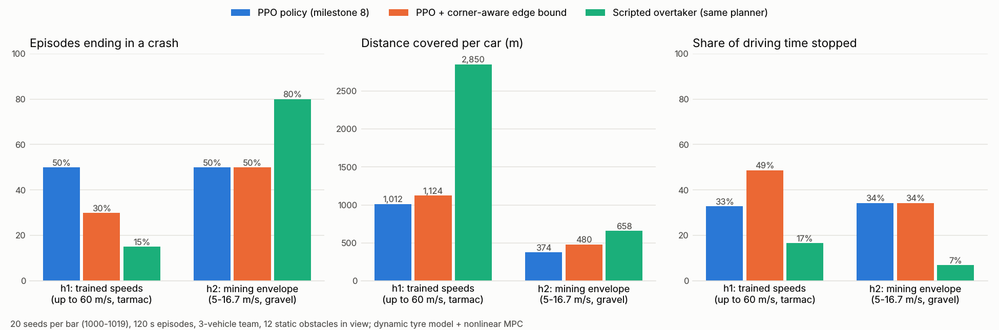

# Haul-road obstacle test (2026-11-15)

**Question:** is the No Hesi stack (milestone 8) a usable basis for autonomous heavy-truck convoys hauling on mining or
logging roads? **Test:** the stack exactly as `run_sim.py` runs it, with the traffic cars replaced by static obstacles.

**Short answer:** the architecture and most of the tooling are a usable basis. The trained policy is not, and the
planner needs a low-speed regime before it can drive a haul road.

## What was run

- **Stack:**
  - the milestone 8 PPO policy (`models/ppo_v10_e5_dyn_b11c_2.75m`, final), with its env config and `run_sim.py`'s planner overrides;
  - planner m4.4, the nonlinear MPC (acados), the dynamic tyre model and the 100 Hz stability layer;
  - three BMW M3s, as trained.
- **Baseline:** the scripted overtaker on the same planner.
- **Obstacles** (`Traffic.static`): 12 car-sized static obstacles (4.79 × 1.90 m), about 3 per 100 m of road.
  - At least 40 m apart in a lane, never sealing the road (no blockades at 45 m), recycled ahead as the team passes.
  - The policy sees them as traffic cars with speed 0 that never merge.
- **Scenarios:**
  - `h1`: v9's road, cars and speed range (70 mph start, up to 60 m/s), obstacles in place of traffic.
  - `h2`: a mining envelope: 45 km/h start, 5–60 km/h commanded (`Scenario.team_speed_min/max`), gravel (μ 0.6).
- **Episodes:** seeds 1000–1019, 120 s each, run by `experiments/haul_road_obstacles.py`. Per-episode rows are in `episodes.csv`, aggregates in `summary.json`.
- **Reference check:** this machine is Linux; the models were trained on Windows. v9 seed 1000 with the same model scores 1,847k with 0 crashes here, against 1,905k in `eval_50seeds_1000-1049_v9.json`, with identical close passes (119). The behaviour reproduces, though not bit for bit.



| 20 seeds each | h1 PPO | h1 PPO + edge bound | h1 overtaker | h2 PPO | h2 PPO + edge bound | h2 overtaker |
|---|---|---|---|---|---|---|
| Crashes | 10 | 6 | **3** | 10 | 10 | 16 |
| … into an obstacle / road edge / teammate | 2 / 7 / 1 | 3 / 3 / 0 | 2 / 1 / 0 | 3 / 7 / 0 | 6 / 3 / 1 | 1 / 15 / 0 |
| Clean runs (no crash, stopped < 25 % of the time) | 0 | 1 | **11** | 0 | 0 | 2 |
| Distance per car (m) | 1,012 | 1,124 | **2,850** | 374 | 480 | 658 |
| Share of time stopped | 33 % | 49 % | 17 % | 34 % | 34 % | 7 % |
| Emergency manoeuvres per episode | 303 | 660 | 105 | 310 | 352 | 178 |

"Edge bound" means `Planner.nmpc_edge_yaw` and `escape_edge_grip`, which keep the body corners inside the road edge
at the plan's heading; both exist but are off by default. Two baseline diagnostics on `h2`, the same 20 seeds:

- **Tarmac (μ 1.05):** 5 crashes.
- **With the edge bound:** 17 crashes (`h2 overtaker_edge` rows).

## Why it fails: three mechanisms, each traced in a replay

1. **The policy drives racing speeds through the obstacle field.**
   - On `h1` seed 1012 it held target speeds of 38–51 m/s (140–180 km/h).
   - Car 1 went into emergency at 32 m/s with an obstacle ahead in its lane, braked at the 8.2 m/s² grip cap for 2.3 s, and still hit it at 13 m/s.
   - It learned in moving traffic, where the car ahead drives away. Its reward pays speed, close passes (< 1.5 m) and 0.35 s drafting.
   - It never learned to slow down for something that stays put: the planner's speed floor was 20 m/s in training, so braking is left entirely to the MPC and the emergency layer.
2. **Standstill deadlock.**
   - The MPC brakes a blocked car to a stop 0.2 m behind the obstacle (its bumper margin is 0.25 m).
   - From there, no forward-only path exists past an obstacle as wide as the car, and the stack has no reverse.
   - Every solve is infeasible, and the fallbacks hold the car still.
   - On `h1` seed 1000, all three cars sit nose-to-obstacle from about 65 s to the end: 6,522 infeasible solves, and the policy's lane-change requests rejected every 0.5 s.
   - The corner-aware edge bound turns several edge crashes into this deadlock, which is why it raises the stopped share to 49 %.
3. **The planner breaks at mining speeds.**
   - On `h2` seed 1004, the baseline car creeps at 5–7 m/s behind an obstacle and accepts a two-lane change. The MPC then fails to solve (its tyre model has a 5 m/s floor, `nmpc_vx_floor`).
   - The lane-keep fallback law takes over with the heading swinging to 31°. The car crosses all three lanes in 2 s and leaves the far edge.
   - Gravel makes it worse (16 crashes against 5 on tarmac at the same speeds). The edge bound doesn't help (17), because the failure is in the fallback chain, not the MPC's bound.
   - Everything was tuned and validated above about 20 m/s. 5–15 m/s with frequent stops is exactly the haul-road regime.

## What carries over, and what doesn't

| Part | Verdict | Why |
|---|---|---|
| Layered architecture: tactical policy → gap rule and masks → per-vehicle MPC → stability layer → verified fallbacks | **Keep** | The shape a haulage convoy needs, and the shape commercial autonomous haulage takes: central fleet coordination, onboard planning, an independent safety layer. |
| Central team coordinator with shared plans, yielding and follow mode | **Keep** | This is convoy control. Retune the gaps for trucks (tens of metres, not 0.35 s). |
| Nonlinear MPC with grip as a hard constraint and plan verification | **Keep, extend** | Needs a low-speed and standstill mode (kinematic model below ~5–8 m/s), reversing, and a standstill gap large enough to steer out. It also needs speed planning that can stop within the clear distance ahead. |
| Dynamic bicycle with Fiala tyres, load transfer, brake/drive split | **Keep as a start** | Works for a rigid truck with new parameters. Needs: a high CG with a rollover (lateral load transfer) limit, 30–400 t payload variation, air-brake lag and retarders, grades. Articulated haulers and log trailers need an articulated model. |
| Trained PPO policy | **Replace** | Its objective (close passes, drafting, speed) is the opposite of haul-road safety, and its observations are fixed to 3 lanes and 8 car-sized objects. Retrain on a haulage reward (throughput, clearance, smoothness, fuel) with obstacles in training. |
| Scenario, metrics, seeded replay, CARLA bridge | **Keep** | Static obstacles and the speed envelope took ~30 lines. Curves, single-lane roads with passing bays, oncoming traffic and varied obstacle sizes are the next scenario work. |
| Perception | **Missing** | Everything here is ground truth. Dust, GPS loss in pits and obstacle classification come later. |

## Suggested next steps, in order

1. **Planner at 0–15 m/s:** a low-speed model and fallbacks, a standstill margin plus reverse, and obstacle-aware speed limits. Validate with the scripted overtaker on `h2` until it is clean.
2. **Truck vehicle model:** rigid haul truck parameters and a rollover constraint in the MPC. An articulated variant if ADTs or log trailers are in scope.
3. **Haul-road scenarios:** curves and grades, 1–2 lanes with passing bays and oncoming traffic, mixed obstacle sizes.
4. **Retrain the policy** on a haulage reward in those scenarios, warm-starting nothing from the No Hesi policy except the training infrastructure.

## Reproduce

```bash
.venv/bin/python experiments/haul_road_obstacles.py --scenarios h1,h2 --policies ppo,overtaker,ppo_edge --seeds 1000-1019 --store 1000
```

Diagnostics: the same command with `--scenarios h2 --policies overtaker --friction 1.05`, and with `--policies overtaker_edge`. Then `--plot-only --scenarios all --policies all` redraws `summary.json`/`summary.png`.

Stored seed-1000 episodes (GIF, plots, metrics):

| Run | Scenario and policy |
|---|---|
| `results/run_072_…` | h1 PPO |
| `run_073` | h1 PPO + edge bound |
| `run_074` | h2 PPO |
| `run_075` | h2 PPO + edge bound |
| `run_076` | h1 overtaker |
| `run_077` | h2 overtaker |

On Linux the nonlinear MPC needs acados built from source, with `ACADOS_SOURCE_DIR`, `NOHESI_ACADOS_BUILD` and `LD_LIBRARY_PATH` set.
